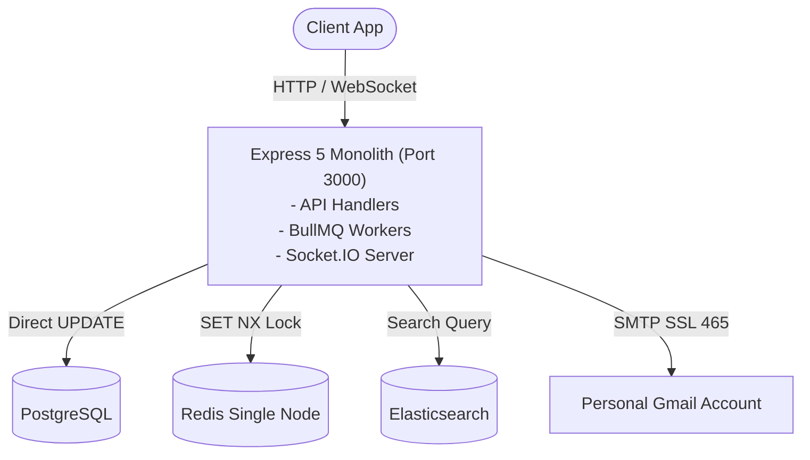
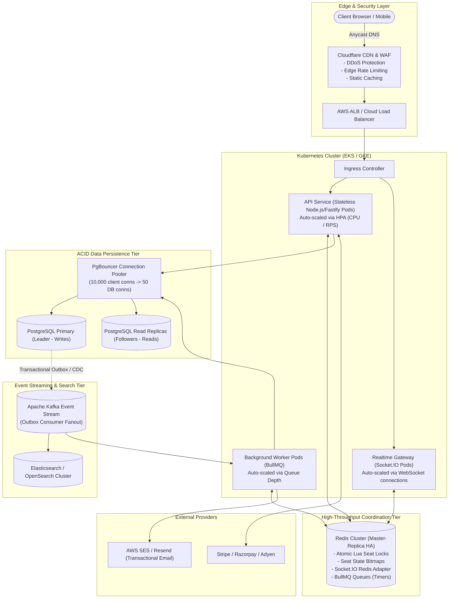
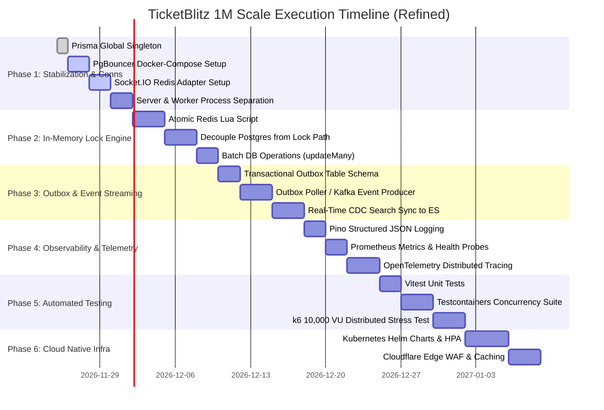

# 🚀 TicketBlitz: The 1-to-1,000,000 Users Engineering Blueprint

> **Mission Statement:** Documenting the end-to-end architectural transformation of TicketBlitz from a prototype movie reservation backend into an enterprise-grade, high-concurrency distributed ticketing engine capable of handling **1,000,000 users** and peak flash-sale spikes (e.g., Coldplay / Marvel premiere demand) with **zero double-bookings, sub-50ms latency, and 99.99% availability**.

---

## 📑 Table of Contents
1. [Traffic Math & Capacity Planning (1M Users Scale)](#1-traffic-math--capacity-planning-1m-users-scale)
2. [Current Architecture (Baseline v1.0) & Bottlenecks](#2-current-architecture-baseline-v10--bottlenecks)
3. [Target Architecture (The 1M Scale Blueprint)](#3-target-architecture-the-1m-scale-blueprint)
4. [The Critical Flaws & Audit Findings](#4-the-critical-flaws--audit-findings)
5. [The Core Solution: Two-Tier In-Memory Reservation Engine](#5-the-core-solution-two-tier-in-memory-reservation-engine)
6. [Architectural Deep Dives (Key Design Decisions)](#6-architectural-deep-dives-key-design-decisions)
   - [Deep Dive 1: What is a Database Connection & Why PgBouncer?](#deep-dive-1-what-is-a-database-connection--why-pgbouncer)
   - [Deep Dive 2: Socket.IO Across Horizontal Pods (Redis Adapter)](#deep-dive-2-socketio-across-horizontal-pods-redis-adapter)
   - [Deep Dive 3: BullMQ vs. Apache Kafka (Task Queue vs. Event Streaming)](#deep-dive-3-bullmq-vs-apache-kafka-task-queue-vs-event-streaming)
7. [The Refined 6-Phase Scaling Roadmap](#7-the-refined-6-phase-scaling-roadmap)
   - [Phase 1: Stabilization, Process Separation & PgBouncer](#phase-1-stabilization-process-separation--pgbouncer)
   - [Phase 2: In-Memory Locking Engine (Redis Lua)](#phase-2-in-memory-locking-engine-redis-lua)
   - [Phase 3: Transactional Outbox Pattern & Event-Driven CDC](#phase-3-transactional-outbox-pattern--event-driven-cdc)
   - [Phase 4: Observability, Metrics & Structured Logging](#phase-4-observability-metrics--structured-logging)
   - [Phase 5: Automated Testing & Chaos Engineering](#phase-5-automated-testing--chaos-engineering)
   - [Phase 6: Cloud Infrastructure, Orchestration & Edge Caching](#phase-6-cloud-infrastructure-orchestration--edge-caching)
8. [Production Code Blueprints](#8-production-code-blueprints)
9. [The Scalability Checklist & Milestones](#9-the-scalability-checklist--milestones)

---

## 1. Traffic Math & Capacity Planning (1M Users Scale)

Before writing code or selecting infrastructure, we quantify what **1,000,000 users** actually demands from hardware, network, and database layers.

### 1.1 User & Traffic Projections
- **Monthly Active Users (MAU):** $1,000,000$
- **Daily Active Users (DAU):** ~ $100,000$ (assuming a 10% DAU/MAU ratio typical for entertainment ticketing)
- **Normal Steady-State RPS:**
  $$\text{Average RPS} = \frac{100,000 \times 20 \text{ interactions/day}}{86,400 \text{ seconds}} \approx 23 \text{ requests/second}$$
- **The Flash-Sale Phenomenon (Peak Spike):**
  Ticketing systems do *not* experience flat traffic. When tickets for a major concert or blockbuster go live at 12:00 PM:
  - **Concurrent Active Users (CCU):** $25,000 - 50,000$ users hitting the seat map in the first 3 minutes.
  - **Read QPS (Movie info, venue showtimes, live seat maps):** $8,000 - 15,000 \text{ req/sec}$.
  - **Write QPS (Seat lock attempts):** $2,000 - 4,000 \text{ req/sec}$.
  - **Completed Bookings:** $50 - 200 \text{ bookings/sec}$ (bounded by stadium/screen capacity).

### 1.2 Storage & Memory Calculations
- **Redis RAM for Seat Locks:**
  - $1,000$ active shows simultaneously running.
  - $200$ seats per show screen = $200,000$ total seats in circulation.
  - Each lock key: `seat_lock:{showId}:{seatId}` (~64 bytes) + user metadata (128 bytes) = ~200 bytes.
  - Total Redis memory for active locks:
    $$200,000 \times 200 \text{ bytes} \approx 40 \text{ MB}$$
  - Even with 10x headroom, Redis memory for locks is negligible (< 1 GB). The bottleneck is **network I/O and command throughput**, not RAM.
- **PostgreSQL Database Storage:**
  - 1M bookings/year $\times$ 1.5 KB per booking record (including payment and booked seat rows) $\approx 1.5 \text{ GB/year}$.
  - Primary bottleneck in PostgreSQL is **transaction duration, connection pool exhaustion, and row lock serialization**, not disk space.

---

## 2. Current Architecture (Baseline v1.0) & Bottlenecks

### 2.1 Baseline Architecture Flow


### 2.2 Why This Breaks at > 500 Concurrent Users
1. **Database Lock Contention:** The locking endpoint updates PostgreSQL first, then Redis. Under 5,000 concurrent lock attempts, thousands of `UPDATE showSeat` queries queue on the same rows, exhausting Postgres connection pools.
2. **Multiple Unshared Prisma Instances:** 4 separate `new PrismaClient()` calls create up to 40 connections *per server process*, quickly crashing Postgres.
3. **In-Memory WebSockets:** Socket.IO has no cluster adapter. Running multiple API replicas causes rooms to be isolated per pod, missing live updates across users.
4. **Co-located Workers:** Background workers run in the same thread as the HTTP API. CPU-intensive jobs or worker crashes take down the entire API server.
5. **SMTP Rate Limits:** Personal Gmail accounts ban traffic when sending more than ~100-500 emails/day.

---

## 3. Target Architecture (The 1M Scale Blueprint)



---

## 4. The Critical Flaws & Audit Findings

| Category | Identified Flaw | Root Cause in Code | Failure Mode at Scale | SDE-3 Remediation |
| :--- | :--- | :--- | :--- | :--- |
| **Concurrency** | Dual-write race condition & DB-first locking | `src/services/seat.service.ts` line 18 (`prisma.showSeat.update` followed by `redisClient.set`) | 5,000 users clicking the same seat will execute 5,000 DB writes. Severe row lock serialization and DB crash. | **Redis-first atomic Lua script**. Postgres is untouched during seat reservation. |
| **Concurrency** | Partial locks & deadlocks on multi-seat selection | `src/controllers/seat.controller.ts` line 28 (Imperative `for (const seatId of seatIds)` loop) | User 1 locks [A, B] while User 2 locks [B, A]. Both get half, both fail, causing lock thrashing. | Atomic Lua reservation: all requested seats are locked atomically in one step or none are. |
| **Memory / Conns** | Multiple unpooled PrismaClient instances | `seat.service.ts`, `auth.controller.ts`, `sync.ts`, `config/prisma.ts` | 4 instances $\times$ 10 default connections $\times$ N server pods = instant `FATAL: too many connections`. | Enforce single singleton `prisma` export; place PgBouncer in front of PostgreSQL. |
| **Realtime** | Socket.IO in-memory broadcast isolation | `src/sockets/index.ts` line 8 (`new Server(server)`) | Scaling API to multiple containers causes room events to stay trapped in one pod. Other users don't see seat updates. | Add `@socket.io/redis-adapter` to distribute room broadcasts across all pods. |
| **Reliability** | API & Worker process co-location | `src/index.ts` lines 94-98 (`initSeatUnlockWorker()`, `initNotificationWorker()`) | Worker CPU stalls block HTTP handling; worker crashes bring down the web server; auto-scaling API duplicates workers. | Split into two discrete binaries: `server.ts` (API/WS) and `worker.ts` (BullMQ consumers). |
| **Database** | N+1 sequential queries in transaction | `src/services/booking.service.ts` lines 70-83 (Sequential loop updating `showSeat` and `bookedSeat`) | Long open database transaction holds row locks for hundreds of milliseconds, choking DB throughput. | Replace with batch operations: `prisma.showSeat.updateMany` and `prisma.bookedSeat.createMany`. |
| **Email** | Gmail SMTP per-request connection | `src/config/mail.ts` (`createRealTransporter()` inside handler) | Gmail bans account after ~500 emails/day; TCP/TLS handshake latency on every email. | Integrate AWS SES or Resend with persistent connection pooling. |
| **Search Sync** | Manual batch script for Elasticsearch | `src/sync.ts` requires manual `npx tsx src/sync.ts` | Stale search catalog when shows/movies are updated or cancelled. | Use Transactional Outbox pattern or Change Data Capture (CDC via Debezium). |
| **Observability** | Plain `console.log` and `morgan('dev')` | Raw console output throughout controllers and services | Unstructured, unparseable logs without correlation IDs; impossible to debug distributed traces across microservices. | Implement Pino structured JSON logging + OpenTelemetry distributed tracing + Prometheus metrics. |
| **Testing** | Zero automated test coverage | No test runner configured in `package.json` | Any refactoring risks silent double-booking bugs and data corruption in production. | Vitest unit tests + Testcontainers integration testing for real concurrent locks. |

---

## 5. The Core Solution: Two-Tier In-Memory Reservation Engine

To protect the database during massive traffic bursts, we decouple **reservation holds** from **financial booking settlement**.

### 5.1 The Two-Tier State Machine
```mermaid
stateDiagram-v2
    [*] --> AVAILABLE : Seed / Show Creation
    
    AVAILABLE --> RESERVED_IN_REDIS : User Selects Seat (Atomic Redis Lua)
    note right of RESERVED_IN_REDIS : In-memory lock with 10-min TTL.\nPostgreSQL is NOT touched.
    
    RESERVED_IN_REDIS --> AVAILABLE : Timer Expires OR User Deselects
    note right of AVAILABLE : Redis key deleted / expired.\nWebSocket emits 'seat_unlocked'.
    
    RESERVED_IN_REDIS --> PAYMENT_PENDING : User clicks "Checkout"
    note right of PAYMENT_PENDING : Order created in DB (status=PENDING).\nPayment Gateway token issued.
    
    PAYMENT_PENDING --> BOOKED : Payment Webhook SUCCESS
    note right of BOOKED : Single ACID Transaction:\n1. ShowSeat status = BOOKED\n2. Booking status = CONFIRMED\n3. Redis Lock Cleared\n4. BullMQ Job Cancelled\n5. Insert OutboxEvent
    
    PAYMENT_PENDING --> AVAILABLE : Payment Fails / Webhook Timeout
```

### 5.2 Atomic Redis Lua Script (Multi-Seat Lock)
This script runs inside Redis's single-threaded event loop, guaranteeing **100% atomicity with zero race conditions**:

```lua
-- KEYS: Array of lock keys (e.g. ["seat_lock:show1:A1", "seat_lock:show1:A2"])
-- ARGV[1]: userId
-- ARGV[2]: lock duration in seconds (e.g. 600)

-- Step 1: Verification Pass (Ensure EVERY requested seat is free)
for i, key in ipairs(KEYS) do
    if redis.call("EXISTS", key) == 1 then
        -- Return 0 and the first colliding key so client knows which seat failed
        return {0, key}
    end
end

-- Step 2: Acquisition Pass (Lock ALL requested seats)
for i, key in ipairs(KEYS) do
    redis.call("SET", key, ARGV[1], "EX", ARGV[2])
end

-- Return 1 indicating total acquisition success
return {1, "OK"}
```

---

## 6. Architectural Deep Dives (Key Design Decisions)

### Deep Dive 1: What is a Database Connection & Why PgBouncer?
- **What a Connection Actually Is:** A connection is not a trivial memory reference. It is a live TCP socket wired to a **dedicated Linux OS fork process** inside PostgreSQL (`postmaster` spawns a process with PID, allocating 5–15 MB RAM).
- **The PostgreSQL Bottleneck:** Standard PostgreSQL has a default `max_connections = 100`. If 100 connections are held, the 101st request is violently rejected with `FATAL: sorry, too many clients already`.
- **The Solution (PgBouncer in Transaction Mode):**
  PgBouncer acts as a lightweight C-based proxy sitting between Node.js and PostgreSQL. It can hold **20,000 idle client TCP sockets** using negligible memory, and multiplexes their queries over a tight, high-performance pool of **50 real PostgreSQL server processes**.
  $$\text{10,000 App Requests} \longrightarrow \text{PgBouncer (Holds 10k sockets)} \longrightarrow \text{PostgreSQL (50 CPU-matched processes)}$$

### Deep Dive 2: Socket.IO Across Horizontal Pods (Redis Adapter)
- **The Problem:** In-memory Socket.IO stores room subscriber lists in local Node.js process RAM. When scaling out to Pod A and Pod B, a user on Pod A locking a seat does not notify users connected to Pod B.
- **The Solution:** We mount `@socket.io/redis-adapter` backed by two Redis clients (Publisher and Subscriber). Any event emitted to `show_${showId}` on Pod A is published to Redis Pub/Sub, which instantly fans out the message to Pod B, Pod C, and all connected clients.
- **Transport Optimization:** Disable long-polling fallbacks (`transports: ['websocket']`). Pure WebSockets avoid HTTP upgrade roundtrips and connection churn on reverse proxies.

### Deep Dive 3: BullMQ vs. Apache Kafka (Task Queue vs. Event Streaming)
A common architectural trap is attempting to replace BullMQ with Kafka for seat auto-unlocking. They solve completely different problems:

| Feature / Responsibility | **BullMQ (Redis)** | **Apache Kafka** |
| :--- | :--- | :--- |
| **Core Architecture** | In-Memory Task Queue & Timer Engine | Distributed Immutable Commit Log |
| **Delayed Execution (10-min Timer)** | **Native ($O(\log N)$)** via Redis Sorted Sets (`ZSET`). | **Anti-pattern.** Causes head-of-line partition blocking. |
| **Job Cancellation on Early Payment** | **Native ($O(1)$)** via `job.remove()` using Job ID. | **Impossible.** Cannot mutate or delete messages in a log. |
| **Post-Booking Multi-Service Fanout** | Requires coupling API to 5 separate queues. | **Native.** Publish once to `bookings.confirmed`, 5 consumer groups read independently. |
| **Event Replayability & CDC** | Completed jobs are pruned. | Messages retained for days/months; full replayability. |

**The Architectural Split:**
- **BullMQ:** Owns the **Time-Wheel & Retries** (10-minute seat unlock timers, early timer cancellation upon payment, and email delivery backoff).
- **Kafka / Event Bus:** Owns **Post-Booking Asynchronous Fanout** (Tax invoicing, PDF generation, real-time CDC sync to Elasticsearch, analytics).

---

## 7. The Refined 6-Phase Scaling Roadmap



### Phase 1: Stabilization, Process Separation & PgBouncer ✅ *(Completed — [Detailed Docs](./Phase-1/README.md))*
- **Goal:** Eliminate memory leaks, connection exhaustion, and process coupling from Day 1.
- **Completed Items:**
  1. Audited all `@prisma/client` imports (`seat.service.ts`, `auth.controller.ts`, `sync.ts`, `seed.ts`) and enforced a single global singleton via `src/config/prisma.ts`.
  2. Added **PgBouncer** (`POOL_MODE=transaction`) on port `6432` in `docker-compose.yml` + `directUrl` and `?pgbouncer=true` support in Prisma.
  3. Installed `@socket.io/redis-adapter` & `@socket.io/redis-emitter` in `src/sockets/index.ts` (4 KB max buffer, pure WebSockets, universal `broadcastToShow()`).
  4. Decoupled processes into `src/server.ts` (API + WebSockets) and `src/worker.ts` (BullMQ workers).
  5. Implemented `/health/live`, cached `/health/ready` (Postgres & Redis critical, ES graceful degradation), and 5s LB-deregistration graceful shutdown on `SIGTERM`/`SIGINT`.

### Phase 2: In-Memory Locking Engine (Redis Lua) ✅ *(Completed — [Detailed Docs](./Phase-2/README.md))*
- **Goal:** Sub-5ms atomic seat lock operations; zero PostgreSQL writes during seat selection, zero double-bookings under crash/drift.
- **Action Items:**
  1. Create `src/validators/seat.validator.ts` with Zod validation (CUIDs, max 10 seats cap, deduplication preventing `["A1", "A1"]` self-sabotage).
  2. Create `src/services/lock.service.ts` with atomic multi-seat Redis Lua scripts using `{showId}` cluster hash tags, lazy `show_booked:{showId}` + `show_hydrated:{showId}` cache hydration, and unique `lockToken` (`userId:uuid`) owner-verified unlocks.
  3. Eliminate preliminary PostgreSQL `showSeat.update` calls during locking.
  4. Schedule one single batch BullMQ delayed job for expiry WebSocket notifications (`broadcastToShow`).
  5. Refactor `booking.service.ts` to verify Redis locks, run atomic `tx.showSeat.updateMany(..., status: 'AVAILABLE')` + `updated.count === seatIds.length` assertion (Guardrail #2 backed by `BookedSeat.showSeatId @unique`), batch `tx.bookedSeat.createMany`, self-heal Redis drift, and emit via `broadcastToShow()`.

### Phase 3: Transactional Outbox Pattern & Event-Driven CDC
- **Goal:** Decouple post-booking side effects (email, invoices, search updates) with guaranteed delivery.
- **Action Items:**
  1. Add `OutboxEvent` table to `prisma/schema.prisma` (`id, aggregateType, eventType, payload, status, createdAt`).
  2. Inside `confirmBookingTransaction`, write the booking record AND insert an `OutboxEvent` in the same database transaction.
  3. Implement an Outbox Poller / Kafka producer that reads unpublished events and emits them to the event bus.
  4. Build automated consumers:
     - **Search Sync Consumer:** Automatically updates Elasticsearch movie/show seat availability in real time (decommissioning manual `sync.ts`).
     - **Notification Consumer:** Pushes email jobs to BullMQ / AWS SES.

### Phase 4: Observability, Metrics & Structured Logging
- **Goal:** Complete visibility into system latency, connection pools, and lock contention.
- **Action Items:**
  1. Replace `console.log` and `morgan` with **Pino**:
     - JSON formatted logs in production.
     - AsyncLocalStorage middleware injecting `traceId`, `reqId`, and `userId` into all logs.
  2. Instrument app with `prom-client` exposing `/metrics`:
     - RED Metrics: Rate, Errors, Duration (p50, p95, p99).
     - Custom Business Metrics: `seat_lock_attempts_total{status="acquired|conflict|error"}`.
  3. *(Done in Phase 1)* Kubernetes-ready health probes (`/health/live` & cached `/health/ready`).
  4. Configure OpenTelemetry distributed tracing across Express, Prisma, Redis, and BullMQ.

### Phase 5: Automated Testing & Chaos Engineering
- **Goal:** Mathematical proof of zero race conditions and zero double-bookings.
- **Action Items:**
  1. Set up **Vitest** for instant domain logic unit tests.
  2. Set up **Testcontainers**:
     - Automated test harness spinning up real PostgreSQL and Redis containers.
     - **Race Condition Stress Test:** Fire 100 concurrent promises attempting to lock the exact same seat simultaneously. Assert that exactly 1 returns HTTP 200 and 99 return HTTP 409.
  3. Run distributed **k6 load test**:
     - Validate 5,000 RPS on movie search with p95 < 50ms.
     - Validate 2,000 RPS on seat locks with p95 < 20ms.

### Phase 6: Cloud Infrastructure, Orchestration & Edge Caching
- **Goal:** Production-grade deployment and automatic elasticity.
- **Action Items:**
  1. Multi-stage Docker builds (`Dockerfile.api`, `Dockerfile.worker`).
  2. Kubernetes manifests with Horizontal Pod Autoscaler (HPA) triggered by CPU and custom Redis queue depth metrics.
  3. Cloudflare Edge WAF setup for rate-limiting brute force bots and caching static catalog assets.

---

## 8. Production Code Blueprints

### 8.1 Single Prisma Client Singleton (`src/config/prisma.ts`)
```typescript
import { PrismaClient } from '@prisma/client';

const globalForPrisma = global as unknown as { prisma: PrismaClient };

export const prisma =
  globalForPrisma.prisma ||
  new PrismaClient({
    log: process.env.NODE_ENV === 'development' ? ['query', 'error', 'warn'] : ['error'],
  });

if (process.env.NODE_ENV !== 'production') globalForPrisma.prisma = prisma;
```

### 8.2 Scalable Socket.IO with Redis Adapter (`src/sockets/index.ts`)
```typescript
import { Server } from 'socket.io';
import { Server as HttpServer } from 'http';
import { createAdapter } from '@socket.io/redis-adapter';
import { redisClient } from '../config/redis';

let io: Server;

export const initSockets = (server: HttpServer) => {
  const pubClient = redisClient;
  const subClient = pubClient.duplicate();

  io = new Server(server, {
    cors: {
      origin: process.env.CORS_ORIGIN || '*',
      methods: ['GET', 'POST'],
    },
    adapter: createAdapter(pubClient, subClient),
    transports: ['websocket'], // Pure WebSockets avoids polling connection churn
  });

  io.on('connection', (socket) => {
    socket.on('join_show', (showId: string) => {
      socket.join(`show_${showId}`);
    });

    socket.on('leave_show', (showId: string) => {
      socket.leave(`show_${showId}`);
    });
  });

  return io;
};

export const getIO = (): Server => {
  if (!io) throw new Error('Socket.io not initialized!');
  return io;
};
```

### 8.3 PgBouncer Docker Service (`docker-compose.yml`)
```yaml
  pgbouncer:
    image: edoburu/pgbouncer:v1.22.1
    container_name: bms2_pgbouncer
    restart: unless-stopped
    environment:
      - DB_USER=bms2
      - DB_PASSWORD=bms2password
      - DB_HOST=postgres
      - DB_PORT=5432
      - DB_NAME=bms2db
      - POOL_MODE=transaction
      - MAX_CLIENT_CONN=10000
      - DEFAULT_POOL_SIZE=25
      - MIN_POOL_SIZE=5
      - RESERVE_POOL_SIZE=5
    ports:
      - "6432:6432"
    depends_on:
      postgres:
        condition: service_healthy
```

---

## 9. The Scalability Checklist & Milestones

Track implementation progress as TicketBlitz levels up:

### Architecture & Concurrency
- [x] Remove duplicate `PrismaClient` instantiations across all files (Phase 1)
- [x] Add PgBouncer to `docker-compose.yml` in transaction pooling mode (Phase 1)
- [x] Add `@socket.io/redis-adapter` for multi-instance WebSocket sync (Phase 1)
- [x] Separate server into `server.ts` (API/WS) and `worker.ts` (BullMQ) (Phase 1)
- [x] Implement atomic Redis Lua script for multi-seat reservation (Phase 2)
- [x] Decouple seat locking from direct PostgreSQL writes (Phase 2)
- [x] Refactor `booking.service.ts` to use batch updates (`updateMany`, `createMany`) (Phase 2)
- [ ] Implement Transactional Outbox pattern for post-booking events (Phase 3)

### Reliability & Observability
- [ ] Replace `console.log` with structured JSON logger (Pino) (Phase 4)
- [ ] Implement request tracing with Request ID / Correlation ID (Phase 4)
- [ ] Expose Prometheus metrics endpoint (`/metrics`) (Phase 4)
- [x] Implement Kubernetes Liveness and Readiness probes (`/health/live`, `/health/ready`) (Phase 1)
- [x] Graceful shutdown handler (`SIGTERM` / `SIGINT`) draining HTTP conns and queues (Phase 1)

### Testing & Quality Assurance
- [ ] Set up Vitest unit test suite
- [ ] Set up Testcontainers integration test suite (Postgres + Redis)
- [ ] Write 100-user race condition test verifying zero double-bookings
- [ ] Run k6 load test asserting p95 < 100ms under 2,000 concurrent VUs
- [ ] Configure GitHub Actions CI pipeline running lint, typecheck, and tests

---
*Maintained with pride by the TicketBlitz Engineering Team. Built to scale.*
