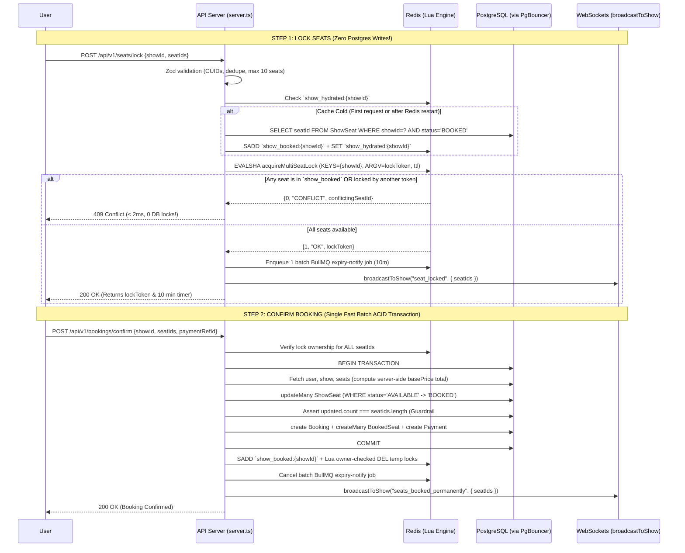

# ⚡ Phase 2: Two-Tier In-Memory Reservation Engine (Redis Lua + Batch ACID)

> **Milestone:** Phase 2 of the TicketBlitz 1-to-1,000,000 Scale Transformation  
> **Target:** Eliminate database lock contention during flash-sale spikes by moving temporary seat holds exclusively into atomic Redis Lua scripts (sub-5ms), while guaranteeing zero double-bookings via atomic batch PostgreSQL updates and schema-level invariants.

---

## 📑 Table of Contents
1. [The 5 Critical Flaws in v1.0 (Architecture Audit)](#1-the-5-critical-flaws-in-v10-architecture-audit)
   - [Flaw 1: DB-First Lock Contention & Split-State Rollback Race](#flaw-1-db-first-lock-contention--split-state-rollback-race)
   - [Flaw 2: Non-Atomic Multi-Seat Loop & AB-BA Deadlocks](#flaw-2-non-atomic-multi-seat-loop--ab-ba-deadlocks)
   - [Flaw 3: Missing Zod Guardrails & Duplicate Seat Self-Sabotage](#flaw-3-missing-zod-guardrails--duplicate-seat-self-sabotage)
   - [Flaw 4: Orphaned Locks & Blind Unlocks](#flaw-4-orphaned-locks--blind-unlocks)
   - [Flaw 5: 2N Sequential Queries Inside an Open Transaction](#flaw-5-2n-sequential-queries-inside-an-open-transaction)
2. [The Redesign: Two-Tier In-Memory Reservation Engine](#2-the-redesign-two-tier-in-memory-reservation-engine)
   - [Sacred Separation of Responsibilities](#sacred-separation-of-responsibilities)
   - [End-to-End Reservation & Booking Sequence](#end-to-end-reservation--booking-sequence)
3. [Deep Dive 1: Atomic Redis Lua Scripts & Cluster Hash Tags](#3-deep-dive-1-atomic-redis-lua-scripts--cluster-hash-tags)
   - [Why Lua Scripts?](#why-lua-scripts)
   - [Redis Cluster Hash Tags (`{showId}`)](#redis-cluster-hash-tags-showid)
   - [Two-Pass Multi-Seat Acquisition Script](#two-pass-multi-seat-acquisition-script)
   - [Owner-Verified Safe Release Script (`lockToken`)](#owner-verified-safe-release-script-locktoken)
4. [Deep Dive 2: Cache Hydration & Dual-Write Crash Consistency](#4-deep-dive-2-cache-hydration--dual-write-crash-consistency)
   - [Why Redis Must Also Track `BOOKED` Seats](#why-redis-must-also-track-booked-seats)
   - [What is Cache Hydration? (And Preventing Cache Penetration)](#what-is-cache-hydration-and-preventing-cache-penetration)
   - [Crash Analysis: Tracing Every Failure Point](#crash-analysis-tracing-every-failure-point)
   - [How Guardrail #2 Works at the SQL Level](#how-guardrail-2-works-at-the-sql-level)
5. [Deep Dive 3: Batching Database Writes (2N to 2 Queries)](#5-deep-dive-3-batching-database-writes-2n-to-2-queries)
   - [Why Sequential Queries Inside Transactions Kill PgBouncer Throughput](#why-sequential-queries-inside-transactions-kill-pgbouncer-throughput)
   - [Batch `updateMany` + `createMany` Blueprint](#batch-updatemany--createmany-blueprint)
   - [Batch BullMQ Expiry Notifications](#batch-bullmq-expiry-notifications)
6. [Phase 2 Component Architecture](#6-phase-2-component-architecture)
7. [Verification & Acceptance Criteria](#7-verification--acceptance-criteria)

---

## 1. The 5 Critical Flaws in v1.0 (Architecture Audit)

Before implementing Phase 2, we audited the locking and booking paths across the seat service, seat controller, and booking service.

### Flaw 1: DB-First Lock Contention & Split-State Rollback Race
In the original `lockSeat()` flow (`src/services/seat.service.ts`):
1. `lockSeat()` executes `prisma.showSeat.update({ where: { showId_seatId, status: 'AVAILABLE' }, ... })` **first**, hitting PostgreSQL directly.
2. Only after Postgres commits does it run `redisClient.set(lockKey, userId, 'EX', 600, 'NX')`.

**Why this breaks under load:**
- If 5,000 fans click Seat `A1` during a flash sale, **all 5,000 requests slam PostgreSQL first**. Postgres serializes all 5,000 connections behind an exclusive row lock on `ShowSeat`. Request #1 wins; the remaining 4,999 wait on the row lock and fail with Prisma error `P2025`. Redis is supposed to shield Postgres—not sit behind it.
- **Hidden Race Window in `unlockSeat()`:** `unlockSeat()` resets Postgres `status = 'AVAILABLE'` **first** and deletes the Redis key **second**. During the milliseconds between those two network calls, `lockSeat()` can succeed in Postgres, hit `redisClient.set(..., 'NX')`, get `null` (because the old Redis key isn't deleted yet), enter `if (!acquired)`, and roll Postgres back to `'AVAILABLE'`!

---

### Flaw 2: Non-Atomic Multi-Seat Loop & AB-BA Deadlocks
In the original `selectSeat()` controller (`src/controllers/seat.controller.ts`):
```typescript
for (const seatId of seatIds) {
  const lockResult = await lockSeat(showId, seatId, userId);
  if (!lockResult.success) {
    // Loop over lockedSeatIds and roll back one by one...
  }
}
```
**The Collision Scenario:**
- Vishal requests `["A1", "A2"]`. Rudra simultaneously requests `["A2", "A1"]`.
- Vishal locks `A1`. Rudra locks `A2`.
- Vishal fails on `A2` and rolls back `A1`. Rudra fails on `A1` and rolls back `A2`.
- **Result:** Both users receive `409 Conflict` even though both seats were unbooked a millisecond earlier (lock thrashing / livelock).

---

### Flaw 3: Missing Zod Guardrails & Duplicate Seat Self-Sabotage
In the original `selectSeat()` handler (`src/controllers/seat.controller.ts`):
- Unlike `confirmBooking`, seat locking performed no Zod schema validation, enforced no max seat cap (allowing a bot to send 300 seat IDs in one call and lock an entire theater), and performed **no deduplication**.
- **Duplicate Self-Sabotage:** If a request sends `seatIds: ["A1", "A1"]` when `A1` is free:
  1. Iteration 1 locks `A1` and pushes `"A1"` into `lockedSeatIds`.
  2. Iteration 2 tries to lock `"A1"` again, fails because Iteration 1 locked it 2ms ago, and triggers the rollback loop—unlocking `A1` and returning `409 Conflict` to the user who just locked it!

---

### Flaw 4: Orphaned Locks & Blind Unlocks
1. **Orphaned Permanent Locks:**
   The controller locked seats in Postgres, emitted Socket.IO via `getIO()` (bypassing `broadcastToShow()`), and *lastly* scheduled the BullMQ unlock job.
   - Because Postgres rows do not expire automatically, **if the pod crashes (`SIGKILL` / OOM kill) between locking and scheduling BullMQ**, no rollback runs and no unlock job exists. That seat stays `LOCKED` in PostgreSQL **forever**.
   - Postgres and Redis cannot participate in a single cross-database ACID transaction to prevent this.
2. **Blind Unlocks:**
   `unlockSeat()` blindly called `redisClient.del(lockKey)` and reset Postgres to `AVAILABLE` without checking *who* owns the lock. If a lock expired 1ms earlier and another user already re-locked the seat, the delayed cleanup wiped out the new user's valid lock.

---

### Flaw 5: 2N Sequential Queries Inside an Open Transaction
In `confirmBookingTransaction()` (`src/services/booking.service.ts`):
```typescript
for (const ss of showSeats) {
  await tx.showSeat.update({ ... });   // Sequential query 1
  await tx.bookedSeat.create({ ... }); // Sequential query 2
}
```
If a user confirms **10 seats**, `await` inside a `for` loop executes **20 sequential database network round-trips** inside an open PostgreSQL transaction (`BEGIN ... COMMIT`):
- PgBouncer (`POOL_MODE=transaction`) **cannot release the underlying Postgres OS process back to the pool until `COMMIT`**.
- Holding row locks and DB connections hostage for 20 sequential round-trips destroys maximum database concurrency.

---

## 2. The Redesign: Two-Tier In-Memory Reservation Engine

### Sacred Separation of Responsibilities

```
┌─────────────────────────────────────────────────────────────────────────┐
│ TIER 1: REDIS (The Speed Shield — Temporary Holds + Booked Set Cache)   │
│ • Absorbs 99.9% of lock stampedes in < 2ms via atomic Lua scripts.      │
│ • Temporary 10-min checkout locks live ONLY in Redis with native TTL.   │
│ • PostgreSQL is 0% touched during seat selection / locking!             │
└────────────────────────────────────┬────────────────────────────────────┘
                                     │
                                     ▼
┌─────────────────────────────────────────────────────────────────────────┐
│ TIER 2: POSTGRESQL (The Incorruptible Truth — Permanent Bookings)       │
│ • ShowSeat.status stays 'AVAILABLE' in Postgres until payment succeeds. │
│ • Only touched once per confirmed booking via fast batch ACID update.   │
│ • Conditional `updateMany` + `BookedSeat.showSeatId @unique` makes      │
│   double-booking mathematically impossible even if Redis loses memory.  │
└─────────────────────────────────────────────────────────────────────────┘
```

---

### End-to-End Reservation & Booking Sequence



---

## 3. Deep Dive 1: Atomic Redis Lua Scripts & Cluster Hash Tags

### Why Lua Scripts?
Redis executes commands in a **single-threaded event loop**. When Redis runs a Lua script via `EVALSHA`, **no other command from any client can interleave** until the entire script finishes.
1. Checking availability and setting locks happens in **one atomic CPU step** with zero race gap.
2. All seats in `seatIds` succeed together or fail together—eliminating partial locks and AB-BA deadlocks in **one single network hop**.
3. **Orphaned Lock Elimination:** `redis.call("SET", key, lockToken, "EX", ttl)` binds the lock and its 600-second self-destruct TTL in the **exact same atomic instruction**. Even if the Node.js pod dies immediately afterward, Redis guarantees the lock vanishes automatically after 600 seconds.

---

### Redis Cluster Hash Tags (`{showId}`)
In a multi-node **Redis Cluster**, data is partitioned across **16,384 hash slots**. Multi-key commands and multi-key Lua scripts **fail with**:
> `CROSSSLOT Keys in request don't hash to the same slot`

unless every key passed into the Lua script maps to the same shard.

By wrapping `showId` in curly braces **`{...}`**, Redis hashes **strictly on the substring inside `{}`**:
- Booked set key: `show_booked:{show_123}`
- Hydration flag key: `show_hydrated:{show_123}`
- Seat lock keys: `seat_lock:{show_123}:seat_A1`, `seat_lock:{show_123}:seat_A2`

Every key for `show_123` lands on the **exact same Redis Cluster node**, making multi-seat Lua scripts 100% cluster-safe.

---

### Two-Pass Multi-Seat Acquisition Script

```lua
-- KEYS[1]: show_booked:{showId}
-- KEYS[2..N+1]: seat_lock:{showId}:{seatId} for each requested seat
-- ARGV[1]: lockOwnerPrefix WITH delimiter (e.g. "user_123:") — prevents user_12 vs user_123 collision
-- ARGV[2]: full unique lockToken for this session (e.g. "user_123:550e8400-e29b...")
-- ARGV[3]: TTL in seconds (e.g. "600")
-- ARGV[4..N+3]: raw seatId strings matching KEYS[2..N+1]

local bookedSetKey = KEYS[1]
local lockOwnerPrefix = ARGV[1]
local newLockValue = ARGV[2]
local ttl = tonumber(ARGV[3])

-- PASS 1: Verification (All-or-Nothing Check)
for i = 2, #KEYS do
  local lockKey = KEYS[i]
  local seatId = ARGV[i + 2]

  -- 1. Check if permanently booked in Redis set
  if redis.call("SISMEMBER", bookedSetKey, seatId) == 1 then
    return {0, "BOOKED", seatId}
  end

  -- 2. Check if currently locked by a DIFFERENT user
  local currentOwner = redis.call("GET", lockKey)
  if currentOwner ~= false then
    if string.sub(currentOwner, 1, string.len(lockOwnerPrefix)) ~= lockOwnerPrefix then
      return {0, "LOCKED", seatId}
    end
  end
end

-- PASS 2: Atomic Acquisition (Every seat verified free or already held by same user)
for i = 2, #KEYS do
  redis.call("SET", KEYS[i], newLockValue, "EX", ttl)
end

return {1, "OK"}
```

---

### Owner-Verified Safe Release Script (`lockToken`)
Why store `userId:uuid` (a unique `lockToken`) instead of just `userId`?
Suppose Vishal locks `A1` at `12:00`, lets it expire at `12:10`, and immediately locks `A1` *again* at `12:10:01`. If a delayed cleanup job from `12:00` fires late, matching only `userId` would wrongly delete Vishal's *brand-new* lock! Storing a unique `lockToken` guarantees **only the exact lock session that acquired the lock can delete it**:

```lua
-- KEYS[1..N]: seat_lock:{showId}:{seatId}
-- ARGV[1]: expected lockToken (e.g. "user_123:uuid")
local deletedCount = 0
for i = 1, #KEYS do
  if redis.call("GET", KEYS[i]) == ARGV[1] then
    redis.call("DEL", KEYS[i])
    deletedCount = deletedCount + 1
  end
end
return deletedCount
```

---

## 4. Deep Dive 2: Cache Hydration & Dual-Write Crash Consistency

### Why Redis Must Also Track `BOOKED` Seats
If we write `BOOKED` to Postgres on payment and simply `DEL seat_lock:{showId}:{seatId}` in Redis (without adding `seatId` to `show_booked:{showId}`):
- Two minutes later, Rudra clicks that exact seat.
- `POST /seats/lock` checks Redis, sees NO lock key, assumes the seat is `AVAILABLE`, and grants Rudra a lock on a seat Vishal already bought!
- Storing permanently booked seats in `show_booked:{showId}` lets Redis reject Rudra in **< 2ms** with zero Postgres traffic.

---

### What is Cache Hydration? (And Preventing Cache Penetration)
Think of a newly started Redis node as a dry sponge—its RAM is empty. **Hydration** means lazily populating `show_booked:{showId}` from PostgreSQL on the first request for a show:

1. Check `EXISTS show_hydrated:{showId}` in Redis.
2. If `1` $\rightarrow$ cache is warm; run Lua script immediately (0 SQL queries).
3. If `0` (Cache Miss / Redis restarted) $\rightarrow$ run **one single read**:
   `SELECT seatId FROM ShowSeat WHERE showId = ? AND status = 'BOOKED'`
4. Populate `SADD show_booked:{showId} ...` and set `SET show_hydrated:{showId} "1" EX 86400`.
*(Notice why the separate `show_hydrated:{showId}` sentinel key is critical: if a show has **0** booked seats, an empty Redis Set automatically vanishes! Without the sentinel flag, every single request would treat the empty set as a cache miss and hit Postgres repeatedly—a classic Cache Penetration bug.)*

---

### Crash Analysis: Tracing Every Failure Point

Because PostgreSQL and Redis are separate network servers, **there is no cross-database atomic commit**. We design around crashes using **The Sacred Order**:
> **PostgreSQL commits FIRST $\longrightarrow$ Redis updates SECOND $\longrightarrow$ Outbox + DB Constraints guarantee recovery.**

*(Never mark `BOOKED` in Redis before Postgres commits—if Postgres rolls back due to a declined card or deadlock, Redis would permanently block an unsold seat!)*

| Crash Point | What Happened? | System State & Automatic Recovery |
| :--- | :--- | :--- |
| **Crash A:** Pod dies *before* payment / Postgres commit | User selected seats, pod crashed mid-request | Postgres untouched (`AVAILABLE`). Redis lock self-destructs automatically in $\le 10$ mins via TTL. |
| **Crash B:** Postgres commits `BOOKED`, pod dies *before* updating Redis | `ShowSeat` is `BOOKED` in DB, but `show_booked` in Redis is stale | 1. **Guardrail #2** inside Postgres rejects any subsequent buyer (0 double-bookings!) and triggers immediate Redis self-healing on conflict.<br>2. **Phase 3 Transactional Outbox** (committed inside the same DB transaction) guarantees the worker syncs `show_booked:{showId}` within seconds.<br>3. *(If a separate `/checkout` step exists, checking `status = 'AVAILABLE'` in the checkout query that already reads `basePrice` blocks payment before money moves.)* |
| **Crash C:** User pays at Stripe/Razorpay, pod dies *before* Postgres commit | Money left user's bank, API pod died before `confirmBookingTransaction` | Production gateways retry **Webhooks** with exponential backoff for up to 72 hours. `Booking.idempotencyKey @unique` prevents duplicate bookings on webhook retries. |
| **Crash D:** Redis loses all RAM (no AOF persistence) | Redis restarts completely empty mid-sale | Next request sees `show_hydrated:{showId}` is missing and **re-hydrates `show_booked:{showId}`** from Postgres. Postgres Guardrail #2 protects any in-flight checkouts. |

---

### How Guardrail #2 Works at the SQL Level

Even if Redis completely evaporated and two users hit `confirmBookingTransaction` at the exact same microsecond for `["A1", "A2"]`, PostgreSQL physically prevents double-booking using two mechanisms:

#### 1. Atomic Conditional Batch Update (`updateMany` + Row Count Assertion)
```typescript
const updated = await tx.showSeat.updateMany({
  where: {
    showId,
    seatId: { in: seatIds },
    status: 'AVAILABLE', // Atomic predicate checked under Postgres row locks
  },
  data: {
    status: 'BOOKED',
    lockedBy: null,
    lockedUntil: null,
    version: { increment: 1 },
  },
});

if (updated.count !== seatIds.length) {
  throw new Error('One or more seats are already booked.');
}
```
Under the hood, PostgreSQL executes:
```sql
UPDATE "ShowSeat"
SET status = 'BOOKED', version = version + 1
WHERE "showId" = $1 AND "seatId" IN ('A1', 'A2') AND status = 'AVAILABLE';
```
- **Concurrent Race:** Vishal and Rudra hit Postgres simultaneously. Postgres locks rows `A1, A2` for Vishal first, updates both (`count = 2`), and commits. Rudra wakes up, evaluates `WHERE status = 'AVAILABLE'`, matches **0 rows** (`count = 0 !== 2`), throws, and aborts cleanly.
- **Partial Conflict:** Rudra requests `["A1", "A2"]` when `A1` is free and `A2` is already `BOOKED`. Postgres updates only `A1` (`count = 1`). Since `1 !== 2`, `throw new Error(...)` causes Postgres to **automatically roll back `A1` to `'AVAILABLE'`**.

#### 2. Schema-Level Padlock (`BookedSeat.showSeatId @unique`)
In `prisma/schema.prisma`, `BookedSeat.showSeatId` has a **`@unique` database index**. Even if application code omitted the `updateMany` check, PostgreSQL's storage engine throws `P2002` (Unique Constraint Violation) if a second booking ever tries to insert a `BookedSeat` for an already booked `ShowSeat`.

---

## 5. Deep Dive 3: Batching Database Writes (2N to 2 Queries)

### Why Sequential Queries Inside Transactions Kill PgBouncer Throughput
In the original `confirmBookingTransaction()` (`src/services/booking.service.ts`), `await` inside `for (const ss of showSeats)` forced Node.js to execute **20 sequential network round-trips** for a 10-seat booking before calling `COMMIT`.
- PgBouncer in `POOL_MODE=transaction` **cannot release the real Postgres backend process until `COMMIT` finishes**.
- Holding a transaction open across 20 sequential network hops dramatically cuts transaction throughput.

### Batch `updateMany` + `createMany` Blueprint
Replacing the imperative loop with two batch operations:
1. `await tx.showSeat.updateMany(...)` $\rightarrow$ **1 SQL `UPDATE`** for all seats.
2. `await tx.bookedSeat.createMany({ data: showSeats.map(...) })` $\rightarrow$ **1 SQL bulk `INSERT`** for all seats.
- **20 sequential DB round-trips $\longrightarrow$ 2 batch round-trips** regardless of seat count.

---

### Batch BullMQ Expiry Notifications
Instead of enqueueing $N$ separate BullMQ jobs inside a loop:
- Enqueue **1 single batch delayed job** (`{ showId, seatIds, lockToken }`) scheduled for 10 minutes (`600,000 ms`).
- When the 10-minute timer fires in `seatUnlockWorker`:
  - Because Redis already expired the temporary lock keys via TTL, the worker **does not need to write to PostgreSQL**.
  - It simply checks which of those `seatIds` are NOT in `show_booked:{showId}` and NOT re-locked by a newer `lockToken`, and broadcasts `seat_unlocked` via `broadcastToShow()`!
- When a booking confirms early (`confirmBookingTransaction`), it removes the single batch BullMQ job only if all seats in that batch were confirmed.

---

## 6. Phase 2 Component Architecture

| Component | Architectural Responsibility |
| :--- | :--- |
| **Seat Validators** (`seat.validator.ts`) | Zod validation enforcing CUIDs, max 10 seats per booking (anti-bot), and `Set` deduplication. |
| **Lua Lock Engine** (`lock.service.ts`) | `{showId}` Redis Cluster hash tags, single-flight lazy cache hydration (`show_hydrated`), atomic multi-seat Lua acquisition, and `lockToken` owner-verified release. |
| **Seat Service & Controller** (`seat.service.ts`, `seat.controller.ts`) | Zero-DB seat locking & owner-verified seat release (`POST /lock`, `POST /release`), broadcasting state via `broadcastToShow()`. |
| **Batch Unlock Queue & Worker** (`seatUnlockQueue.ts`, `seatUnlockWorker.ts`) | Single batch delayed expiry timer per reservation (colon-free `jobId` for BullMQ safety), broadcasting `seat_unlocked` without touching Postgres. |
| **Booking Service** (`booking.service.ts`) | Pre-DB Redis lock verification, idempotent `paymentRefId` checks, atomic `updateMany` + `createMany` Guardrail #2, Redis drift self-healing, and `broadcastToShow()`. |

---

## 7. Verification & Acceptance Criteria

| Scenario | Test / Verification Method | Expected Outcome |
| :--- | :--- | :--- |
| **Zero DB Writes on Lock** | Enable Postgres query logging (`['query']`); call `POST /api/v1/seats/lock` on an already hydrated show. | **0** `UPDATE` or `INSERT` SQL queries executed on PostgreSQL during lock acquisition or 409 conflicts. |
| **Atomic All-or-Nothing Multi-Seat Lock** | Send concurrent requests: Request A `["A1", "A2"]`, Request B `["A2", "A1"]`. | Exactly 1 request locks **both** seats (`200 OK`); the other fails cleanly with `409 Conflict` (**0 partial locks, 0 deadlocks**). |
| **Duplicate Payload Self-Protection** | Call `POST /api/v1/seats/lock` with `seatIds: ["A1", "A1"]`. | Deduplicated to `["A1"]`; locks `A1` cleanly without self-rolling back. |
| **Max Seat Anti-Bot Guardrail** | Call `POST /api/v1/seats/lock` with 15 seat IDs. | Rejected immediately at controller validation with `400 Bad Request`. |
| **Owner-Checked Unlock Safety** | Acquire lock with `tokenA`, simulate `tokenB` attempting to release it. | Lua `GET == ARGV[1]` rejects deletion; `tokenA`'s lock remains intact. |
| **Batch Booking Transaction** | Confirm 10 seats in `POST /api/v1/bookings/confirm`. | `ShowSeat` updated via 1 `updateMany`; `BookedSeat` inserted via 1 `createMany`. |
| **Redis Cold-Start Recovery** | Flush Redis (`FLUSHALL`) after booking Seat `A1`, then attempt `POST /seats/lock` on `A1`. | `show_booked:{showId}` auto-hydrates from Postgres; `A1` is blocked with `409 Conflict`. |

---
*Maintained with pride by the TicketBlitz Engineering Team. Built to scale.*
